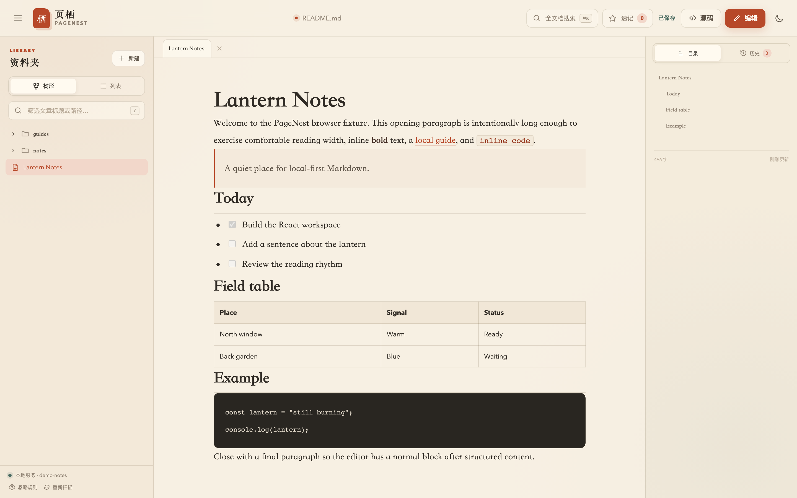

<div align="center">

# 页栖 PageNest

本地优先的 Markdown 阅读、编辑与版本工作台。

[](https://nodejs.org/)
[](https://www.typescriptlang.org/)
[](./LICENSE)
[](https://github.com/ATQQ/pagenest)

[快速开始](#快速开始) · [使用](#使用) · [CLI](#cli) · [项目结构](#项目结构) · [开发](#开发) · [技术方案](./TECHNICAL_PLAN.md)

</div>



PageNest 直接读取指定目录中的 Markdown 文件，用浏览器提供阅读、富文本编辑、源码编辑和版本回溯。正文始终以磁盘文件为唯一数据源，不建立数据库。

## 功能

| 功能       | 说明                                                           |
| ---------- | -------------------------------------------------------------- |
| 本地优先   | 文件留在原目录，可继续使用 Git、iCloud、Dropbox 或任意编辑器   |
| 三种模式   | 阅读、富文本、Markdown 源码，共用同一份本地草稿                |
| 代码高亮   | Shiki 按常用语言高亮，明暗 token 随主题切换                    |
| 全文搜索   | `⌘/Ctrl + K` 搜索标题、路径和正文，支持多关键词与拼写容错      |
| 多文档     | 标签页、章节收藏、滚动位置和侧栏状态持久化                     |
| 历史与冲突 | 保存前快照、历史 diff、版本恢复、SHA-256 并发修改检测          |
| 文件扫描   | 自动合并根目录 `.gitignore`、页面忽略规则和 CLI `--ignore`     |
| 主题       | 八套阅读配色：纸页、羊皮纸、纯白、护眼、豆沙、夜读、墨夜、纯黑 |

## 快速开始

需要 Node.js `>= 22.12` 和 npm。

```bash
git clone https://github.com/ATQQ/pagenest.git
cd pagenest
npm install
npm run build
node ./bin/pagenest.js /path/to/notes
```

不传目录时打开当前目录：

```bash
cd /path/to/notes
node /path/to/pagenest/bin/pagenest.js
```

安装本地全局命令：

```bash
cd /path/to/pagenest
npm link
pn /path/to/notes
```

默认地址为 `http://127.0.0.1:4321/`，按 `Ctrl+C` 停止服务。

## 使用

### 编辑模式

| 模式   | 操作                                                 |
| ------ | ---------------------------------------------------- |
| 阅读   | 默认模式，只浏览文档、搜索和收藏                     |
| 富文本 | 点击顶部「编辑文档」，再点击正文块直接编辑           |
| 源码   | 在编辑控制栏切到「Markdown 源码」，编辑整篇 Markdown |

编辑控制栏会持续显示当前模式和未保存状态：

- 「保存并返回」写入磁盘并回到阅读模式，也可按 `⌘/Ctrl + S`。
- 「取消更改」放弃本次草稿并回到阅读模式。
- 富文本块内按 `Esc` 取消当前块，按 `⌘/Ctrl + Enter` 完成当前块。
- 标题、段落和引用保持原排版编辑；列表、表格、代码块自动使用 Markdown 片段编辑。

### 草稿与历史

- 草稿保存在浏览器 `localStorage`，刷新后可恢复。
- 保存前会为磁盘旧正文创建快照；每篇文档最多保留 200 个历史版本。
- 磁盘文件被其他程序修改后，保存会提示冲突，可查看差异、加载磁盘版本或保留本地修改。

### 面板折叠

- 左侧资料夹和右侧「目录 / 历史」都可以折叠，分隔线中间有一个圆形按钮，点击即可收起或展开。
- 收起后按钮会停在视口边缘，作为再次展开的入口；顶栏的按钮同样可用。
- 折叠状态会记住，刷新后保持。
- **正文始终相对视口居中**：左右面板收起时，正文不会跟着左移或右移，视线不用重新定位。
- 窄屏（≤1023px）下右栏改为底部抽屉、侧栏改为覆盖式抽屉，正文改为在可用空间内居中。

### 主题

右上角主题菜单按「纸感阅读 / 护眼柔和 / 夜间模式」分组提供八套配色：

| 分组 | 主题   | 说明                |
| ---- | ------ | ------------------- |
| 纸感 | 纸页   | 温暖米白，默认主题  |
| 纸感 | 羊皮纸 | 旧书米黄            |
| 纸感 | 纯白   | 中性高亮            |
| 护眼 | 护眼   | 柔和草绿            |
| 护眼 | 豆沙   | 中性米灰            |
| 夜间 | 夜读   | 暖调低亮            |
| 夜间 | 墨夜   | 中性深灰            |
| 夜间 | 纯黑   | OLED 真黑，像素全灭 |

正文始终渲染在一块独立的「纸面」上，底色纯净均匀，不叠加网格或彩色晕染；
八套主题的正文对比度均达到 10:1 以上，标题与代码块达到 AAA 级别。
选择会自动保存。

## CLI

```text
pn [directory] [options]
pagenest [directory] [options]
```

| 参数                  | 说明                                    |
| --------------------- | --------------------------------------- |
| `-p, --port <number>` | 监听端口，默认 `4321`；`0` 表示系统分配 |
| `--host <host>`       | 监听地址，默认 `127.0.0.1`              |
| `--token [token]`     | 启用访问令牌；非本机监听时自动生成      |
| `-i, --ignore <rule>` | 追加 Git-style 忽略规则，可重复         |
| `--open`              | 启动后打开浏览器，默认开启              |
| `--no-open`           | 不自动打开浏览器                        |
| `-h, --help`          | 显示帮助                                |
| `-v, --version`       | 显示版本                                |

```bash
pn ./notes
pn ./docs --port 8080 --no-open
pn ./notes --host 0.0.0.0
pn ./notes --ignore drafts/ --ignore "**/archive/"
```

## 目录与忽略

笔记目录保持原样，PageNest 只额外生成 `.pagenest/`：

```text
your-notes/
├── README.md
├── guides/
│   └── start.md
└── .pagenest/
    ├── settings.json
    └── history/
        └── d-<document-id>/
            ├── index.json
            └── v-<version-id>.md
```

扫描时按顺序合并规则：

1. 跳过 `.git/`、`.pagenest/` 和符号链接。
2. 读取根目录 `.gitignore`。
3. 叠加页面中的忽略规则。
4. 叠加 CLI `--ignore` 参数。

支持 `node_modules/`、`*.draft.md`、`/root-only/`、`!docs/keep.md`、`**/archive/` 等常用 Git-style 写法。当前不读取嵌套 `.gitignore`。

## 项目结构

```text
pagenest/
├── bin/
│   └── pagenest.js            # CLI 发布入口
├── scripts/
│   ├── dev.mjs                # 前端与服务端联合开发
│   └── e2e-server.mjs         # Playwright 测试服务
├── src/
│   ├── cli/
│   │   └── index.ts           # 参数、端口、host、token
│   ├── client/
│   │   ├── components/        # 文档、侧栏、编辑器、弹窗
│   │   ├── markdown/          # 块解析与 Markdown 渲染
│   │   ├── store/             # Zustand 工作区状态
│   │   ├── styles/            # 全局主题变量
│   │   ├── themes.ts          # 主题清单与分组
│   │   ├── App.tsx            # 应用主界面与编辑模式
│   │   └── api.ts             # 前端 API 封装
│   ├── server/
│   │   ├── server.ts          # HTTP、SSE、鉴权与静态资源
│   │   ├── library.ts         # 扫描、保存、历史与冲突处理
│   │   └── ignore.ts          # 忽略规则解析
│   └── shared/
│       └── contracts.ts       # 前后端共享类型
├── test/
│   ├── e2e/                   # Playwright 端到端测试
│   ├── fixtures/              # 测试 Markdown 目录
│   └── *.test.ts              # 单元与集成测试
├── docs/                      # README 截图
├── vite.config.ts
└── package.json
```

`dist/` 为构建产物，运行时自动生成。详细架构见 [TECHNICAL_PLAN.md](./TECHNICAL_PLAN.md)。

## 开发

```bash
npm install
npm run dev -- /path/to/notes
```

开发模式中，Vite 在 `5173` 提供前端 HMR，Node 服务在 `4321` 提供 API 与 SSE。

| 命令                | 用途                   |
| ------------------- | ---------------------- |
| `npm run dev`       | 启动前端与后端开发模式 |
| `npm run build`     | 构建客户端和服务端     |
| `npm test`          | 运行单元与集成测试     |
| `npm run test:e2e`  | 运行 Playwright 验收   |
| `npm run typecheck` | TypeScript 类型检查    |
| `npm run lint`      | ESLint 检查            |
| `npm run verify`    | 执行完整质量检查与构建 |

## 局域网访问

监听非 loopback 地址时会自动启用访问令牌：

```bash
pn ./notes --host 0.0.0.0
```

首次打开带 token 的地址后，服务会写入安全 Cookie。仅应在可信局域网中使用，访问令牌不能替代 HTTPS、防火墙或网络访问控制。

## 已知限制

- 没有账号、云同步、多人协作和公网托管。
- 没有文件监听器；外部修改通过重新扫描、保存哈希校验和 SSE 提示处理。
- 暂不支持公式、Mermaid、内嵌 HTML 和插件。
- 本地图片支持相对路径和根路径；附件和跨 Markdown 文档链接仍在后续规划中。

## License

[MIT](./LICENSE) © PageNest contributors
